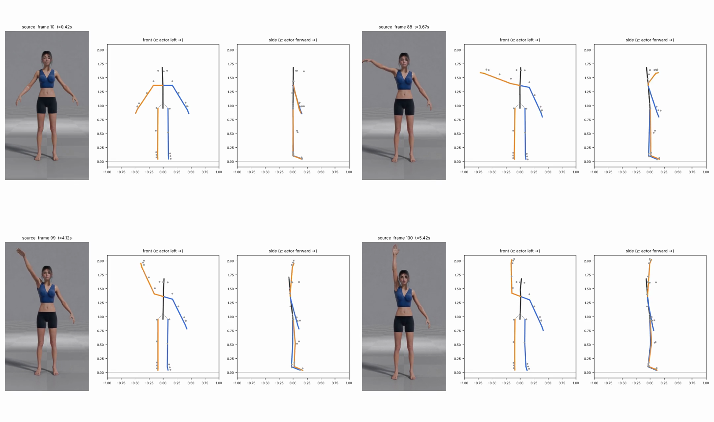
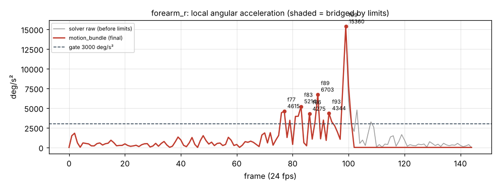

# v1_061c — Подъём ПРАВОЙ руки через сторону вверх

**Вердикт: частично: траектория руки и прямой локоть совпадают, кисть развёрнута не так.** Уровень: *реализовано, функционально прогоняется*. **Качество не принято.**

## Что сломалось
- Траектория руки нормальная: на 99 и 130 кадрах правая рука прямая и вертикально вверх, как в исходнике.
- С ~99 кадра до конца **кисть правой руки развёрнута на ~26° не так, как в видео**: трекер даёт поворот предплечья 116°, лимит режет до 90°, и разницу никто не компенсирует.
- Из-за этого же обрезания **направление правой кисти уезжает на 9.5°** (кадры 113–144) — кисть «отваливается» от трекера.
- Ступни висят на ~4 см над полом всё время (носки задраны на 7°).

## Поведение суставов
- Рывок на подъёме руки, кадры 85–100: предплечье 15 360 °/с² на 99 кадре, плечо 8 265 на 88, кисть 8 317 на 87 — порог 3 000 превышен в 36 точках.
- Поворот предплечья нарастает по ~7° за кадр и **упирается в 90° как в стену** (~102 кадр) — жёсткая остановка вместо плавного торможения.

## Причина бага (гипотеза или подтверждено)
- **Трекер / сырые данные (подтверждено):** все рывки 85–100 одинаковы в сыром выходе солвера и в финальном bundle — пришли из MediaPipe, фильтра нет.
- **Внутренняя логика (подтверждено):** прямая рука не даёт солверу информации о скрутке плеча (референс параллелен кости в 124 из 145 кадров), поэтому вся скрутка плеча записана в предплечье → 116° → лимит 90° → кисть повёрнута неверно. В `limits.py` после обрезания родителя дочерняя кость (кисть) не пересчитывается — отсюда 9.5° ухода кисти.

## Что исправить агенту
1. `limits.py` (`_hinge`, `apply_limits`): излишек скрутки предплечья при почти прямом локте (<20°) переносить в плечо; после любого обрезания пересчитывать локальные повороты детей из их прежней мировой ориентации. Цель: ошибка скрутки кисти < 5° (сейчас p95 19–25°).
2. Мягкое насыщение вместо `np.clip` у границ (последние 10–15°).
3. Временной фильтр (см. обзор, A3).

Подробности и все числа: `dev_audit.json`; графики: `plots/`.
