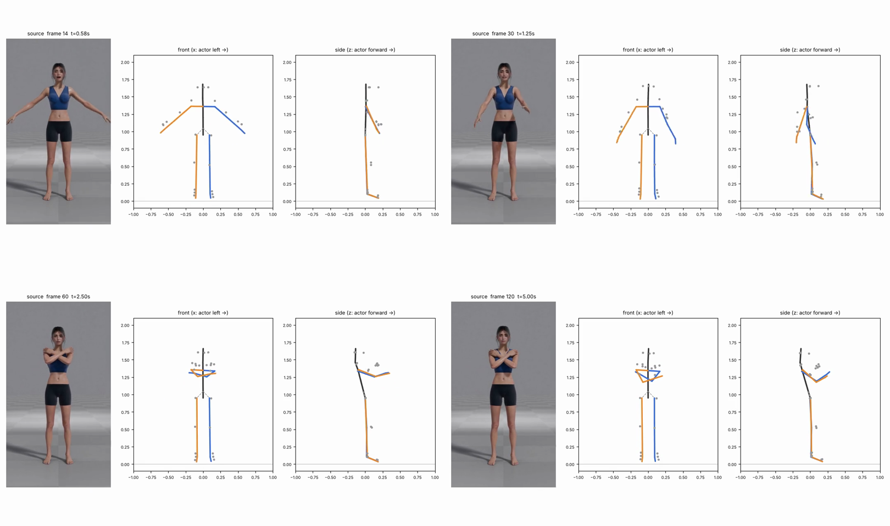
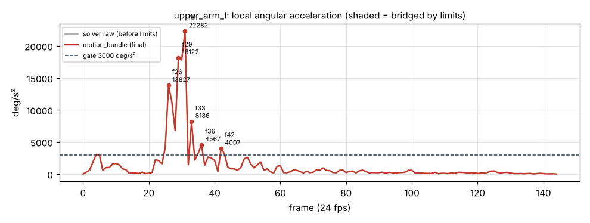

# v1_0663 — Скрестить руки на груди, ладони на плечи

**Вердикт: провал.** Уровень: *реализовано, функционально прогоняется*. **Качество не принято.**

## Что сломалось
- **Ладони не доходят до плеч на 37–46 см** (кадры 60–144): в боковом виде предплечья торчат вперёд на ~30 см перед грудью, кисти ниже плеч. В исходнике ладони лежат на плечах.
- **Локти согнуты всего на 56–64°** вместо ~130°+ — «полускрещённые» руки.
- **Предплечья проходят друг сквозь друга**: минимальное расстояние между осями 0.6 см на 60 кадре, меньше 5 см в 99 кадрах.
- **Корпус откинут назад до 20°** (36 кадр), в видео человек стоит ровно.
- **Кадры 26–33: левая рука дёргается назад и обратно вперёд** (амплитуда ~90° за 7 кадров).

## Поведение суставов
- Самый «грязный» участок — сведение рук, кадры 26–36: плечо левой руки 22 282 °/с² (31 кадр), предплечье 22 171 (30), правое плечо 18 228 (30), правое предплечье 20 776 (36). Скачок до 50° за один кадр.
- 85 точек выше порога. Блок лимитов **ничего не сгладил**: ни одного «моста» за весь клип.
- В удержании (60–144) движение спокойное.

## Причина бага (гипотеза или подтверждено)
- **Трекер (подтверждено):** MediaPipe теряет глубину, когда руки идут к камере: на 30 кадре длина левого предплечья у трекера 0.48 от нормы, плеча — 0.63. Сам трекер ставит ладонь в 28 см перед плечом, а сгиб локтя у него 77–83°. Наклон корпуса назад тоже есть уже в данных трекера (плечи на 11 см позади таза).
- **Внутренняя математика (подтверждено):** «снятие смещения локтя» (`debias_bend`) вычитает ещё ~20° из каждого сгиба: 77–79° → 56–58°, кисть уезжает ещё на 5 см вперёд.
- **Логика (подтверждено):** детектор выбросов ловит только одиночные кадры (порог 25°), а глюк длится 7 кадров — проходит насквозь.

## Что исправить агенту
1. **Блокер:** восстановление глубины по постоянным длинам сегментов актёра (`calibration.py`/новый `depth.py`): если отношение длины < 0.9, глубину брать как √(L² − d²_2D) по `image_joints`. Первый дешёвый эксперимент — модель `--variant heavy`.
2. **Блокер:** `solver.debias_bend` — коррекцию смещения гасить к нулю при сгибе > 2×bias (сейчас она режет весь диапазон).
3. Маска аномалий по `length_ratio` (|r−1| > 0.2 → мост) + временной фильтр.
4. Позже: ограничение наклона корпуса, разведение предплечий (капсулы ~3.5 см).

Подробности и все числа: `dev_audit.json`; графики: `plots/`.
