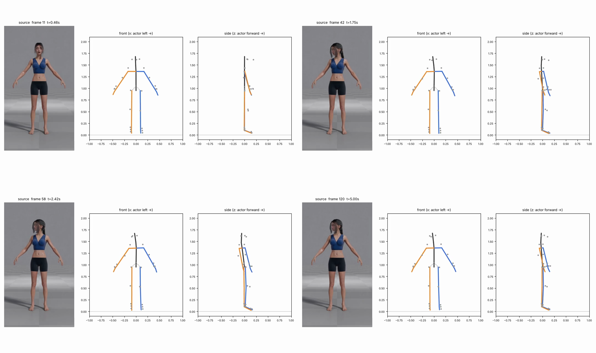

# v1_5313 — Поворот головы вправо с наклоном

**Вердикт: провал по голове, тело в порядке.** Уровень: *реализовано, функционально прогоняется*. **Качество не принято.**

## Что сломалось
- **Голова «возвращается сама»:** поворот доходит до −42° на 60 кадре, а потом за ~12 кадров откатывается до −13…−20° и так до конца. В видео голова остаётся повёрнутой примерно на 50° с 48 кадра до конца.
- Наклон головы почти потерян (максимум −6.7°).
- Корпус «доворачивается» за головой на −22° (58 кадр) — в видео торс фронтален (гипотеза).
- В покое голова уже повёрнута на +7° влево, хотя актриса смотрит прямо.
- В превью поворот головы **вообще не виден** (голова — одна линия), проверял по числам и по 2D-точкам ушей.

## Поведение суставов
- Тело неподвижно и чистое. 20 точек выше порога — все на шее, кадры 40–46 (максимум 4 822 °/с² на 42) — рывок в момент поворота.

## Причина бага (гипотеза или подтверждено)
- **Трекер (подтверждено):** мировые 3D-точки ушей/носа MediaPipe «распрямляют» голову. По 2D-кадру расстояние между ушами падает до 0.48–0.65 от исходного (≈50° поворота) и держится, а 3D-оценка откатывается.
- **Внутренняя калибровка (подтверждено):** калибруется только наклон головы вперёд-назад, поворот и крен в покое — нет, отсюда +7° во всех 8 клипах.
- Поворот корпуса за головой — гипотеза (трекер связывает плечи с головой).

## Что исправить агенту
1. `solver.bone_targets` (голова/шея): оценивать рыскание головы ещё и по `image_joints` (отношение расстояния между ушами к базовому → |yaw| = arccos, знак — по смещению носа) и брать большую по модулю оценку.
2. `calibration.reference_pitch_offsets` → калибровать полную ориентацию головы в покое (yaw и roll тоже).
3. `preview.py`: рисовать «нос» (ось Z головы) и вид сверху, иначе такие клипы нельзя проверить глазами.

Подробности и все числа: `dev_audit.json`; графики: `plots/`.
