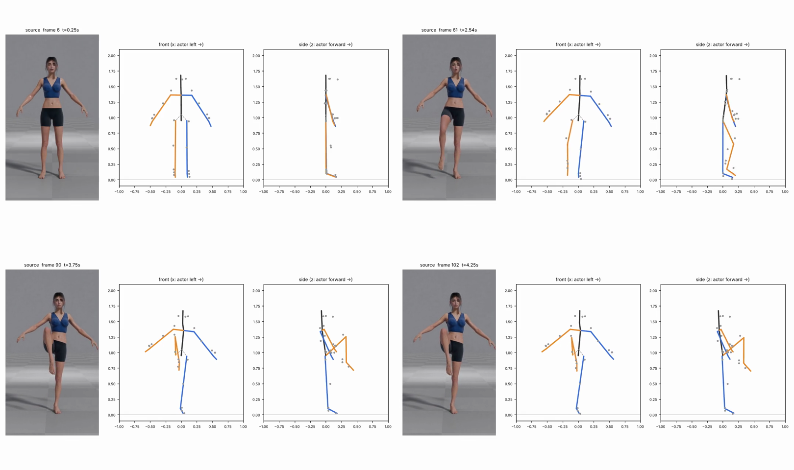
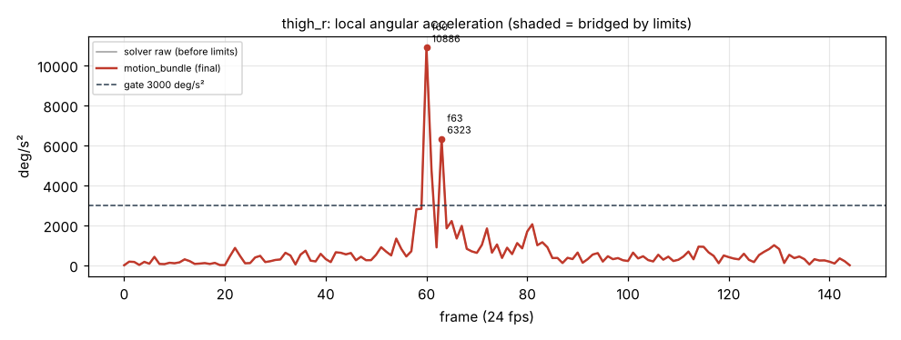

# v1_619b — Подъём ПРАВОГО колена

**Вердикт: в целом приемлемо, рывок на отрыве ноги.** Уровень: *реализовано, функционально прогоняется*. **Качество не принято.**

## Что сломалось
- Подъём и сгиб колена (132°) совпадают с видео (90, 102 кадры), стопа висит под коленом.
- **Бедро поднято примерно на 43° выше горизонтали**, в видео — ближе к горизонтали (гипотеза: точки трекера совпадают с ригом, так что это трекер).
- Поднятая стопа чуть заходит за опорную ногу (кадры 98–106, несколько см), опорная нога наклонена внутрь — потому что таз не может сместиться над опорной стопой (нет перемещения корня).
- Корпус качается вперёд −8° (59 кадр) → назад +8° (107 кадр).
- Опорная стопа висит на 5 см над полом (66–69 кадры).

## Поведение суставов
- **Отрыв ноги на 60–61 кадре — щелчок, а не подъём:** бедро поворачивается на 20.6° за один кадр (494 °/с, 10 886 °/с²), голень — 22.9°. 12 точек выше порога, остальное спокойно.

## Причина бага (гипотеза или подтверждено)
- **Трекер (подтверждено):** рывок 60–61 одинаков в сыром и финальном выходе.
- Перекос опорной ноги — **ограничение конвейера (подтверждено):** корень зафиксирован на высоте 0.95 м, переноса веса нет.

## Что исправить агенту
1. Временной фильтр + маска аномалий (обзор, A3).
2. Калибровать наклон стопы в покое (ступни висят на 4 см во всех клипах).
3. Позже: перенос корня / контакт стоп с полом.

Подробности и все числа: `dev_audit.json`; графики: `plots/`.
