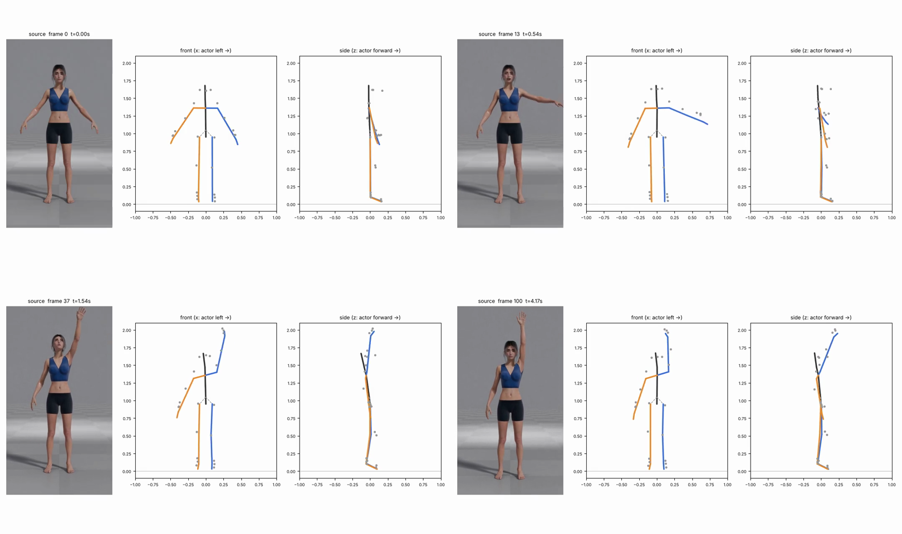

# v1_690b — Подъём ЛЕВОЙ руки через сторону вверх, взгляд вверх

**Вердикт: лучший клип набора.** Уровень: *реализовано, функционально прогоняется*. **Качество не принято.**

## Что сломалось
- Траектория руки, горизонталь на 13 кадре, вертикаль 168° на 37–100 кадрах — совпадают с видео. Локоть прямой.
- Голова поднимается на 14° на 38 кадре — как в видео (актриса смотрит вверх).
- В боковом виде кисть на 25 см впереди плеча — по фронтальному видео проверить нельзя.
- Ступни на ~3.5 см над полом в покое.

## Поведение суставов
- Умеренные рывки: предплечье 5 262 °/с² и кисть 4 649 на 37 кадре, плечо 3 752 на 13 кадре. 15 точек выше порога.

## Причина бага (гипотеза или подтверждено)
- **Трекер (подтверждено):** рывки одинаковы в сыром выходе солвера. Внутренних ошибок не найдено.

## Что исправить агенту
1. Временной фильтр (A3) — но проверить именно на этом клипе, что он не добавляет запаздывания (пик плеча на 13 кадре не должен уехать).

Подробности и все числа: `dev_audit.json`; графики: `plots/`.
