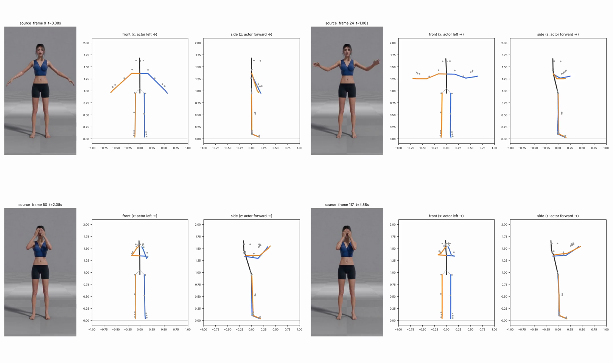
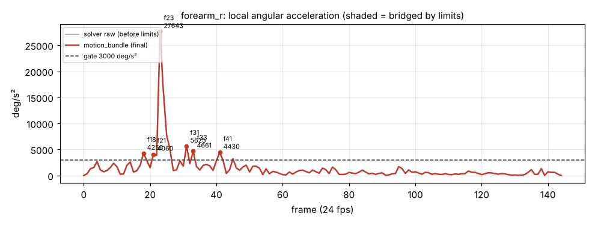

# v1_85a9 — Закрыть лицо обеими руками

**Вердикт: провал.** Уровень: *реализовано, функционально прогоняется*. **Качество не принято.**

## Что сломалось
- **«Руки зомби»: ладони висят в 35–47 см перед лицом** (кадры 38–144) вместо того, чтобы лежать на лице. В боковом виде предплечья вытянуты вперёд на уровне лица.
- **Локти согнуты всего на 32–35°** в удержании, а нужно ~140°.
- **Корпус откинут назад на 18°** (47 кадр), в видео — ровно.
- Кисти почти сходятся (3.9 см) — это нормально, ладони рядом.

## Поведение суставов
- Худший клип по рывкам: **поворот правого предплечья перескакивает с −18° на +18° за один кадр** (23→24, 904 °/с, 27 643 °/с² — максимум по всем прогонам). Левое предплечье 15 103 на 21, правая кисть 13 143 на 32, левое плечо 9 700 на 26.
- 62 точки выше порога, ни одна не сглажена (детектор выбросов дал 24.0° при пороге 25°).

## Причина бага (гипотеза или подтверждено)
- **Трекер (подтверждено):** сам MediaPipe ставит ладони на 31 см перед носом и меряет сгиб локтя 62–64°; длина левого плеча падает до 0.60 от нормы на 40 кадре — потеря глубины.
- **Внутренняя математика (подтверждено):** `debias_bend` срезает ещё ~30° сгиба (62→32°) и отодвигает ладони ещё на 6–7 см вперёд.
- Наклон корпуса назад есть уже в данных трекера.

## Что исправить агенту
1. **Блокер:** восстановление глубины по длинам сегментов (A1).
2. **Блокер:** `solver.debias_bend` — не трогать сгибы больше 2×bias.
3. Маска аномалий по `length_ratio` + фильтр; детектор выбросов — по 5-кадровому окну, а не по одному кадру.
4. Ограничение наклона корпуса назад (A7).

Подробности и все числа: `dev_audit.json`; графики: `plots/`.
