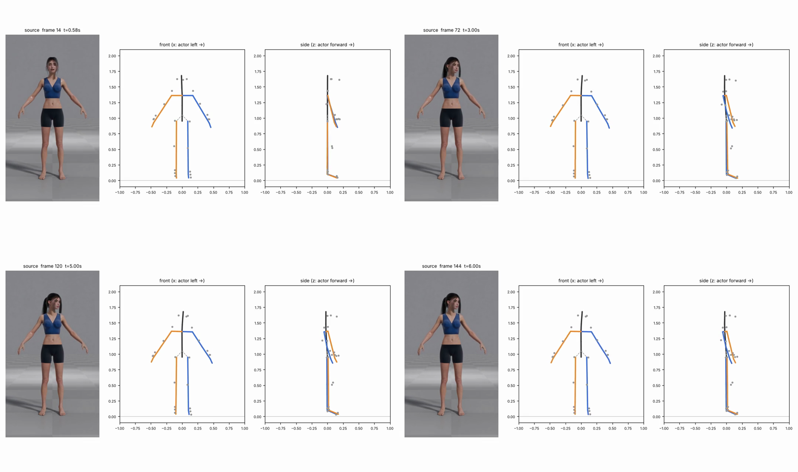

# v1_9645 — Поворот головы влево

**Вердикт: провал по голове, тело идеально спокойное.** Уровень: *реализовано, функционально прогоняется*. **Качество не принято.**

## Что сломалось
- **Голова поворачивается в 2.5–3 раза меньше, чем в видео:** итог 24° (из них 7° — ошибка покоя, т.е. ~17° чистого поворота), а по 2D-кадру поворот ≈50° (расстояние между ушами 0.63 от исходного).
- Шея скручена на 13°, корпус доворачивается на 11° — в видео торс неподвижен (гипотеза: трекер).
- В превью поворот головы не виден вообще.

## Поведение суставов
- Чисто: **0 точек выше порога**, максимум 2 748 °/с² (таз). Лучшая стабильность в наборе.

## Причина бага (гипотеза или подтверждено)
- **Трекер (подтверждено):** 3D-точки ушей/носа MediaPipe недооценивают поворот; 2D-точки показывают ≈50°.
- **Внутренняя калибровка (подтверждено):** рыскание головы в покое не калибруется (+7.3°).

## Что исправить агенту
1. Оценка поворота головы по 2D-ушам и носу, слияние с 3D (A6).
2. Калибровка полной ориентации головы в покое.
3. `preview.py`: ось «нос» и вид сверху.

Подробности и все числа: `dev_audit.json`; графики: `plots/`.
