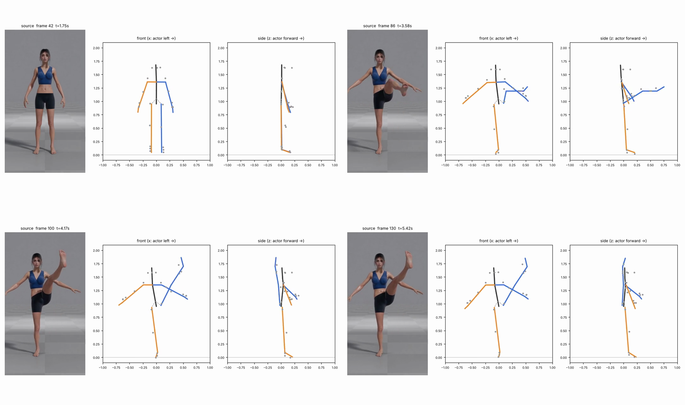
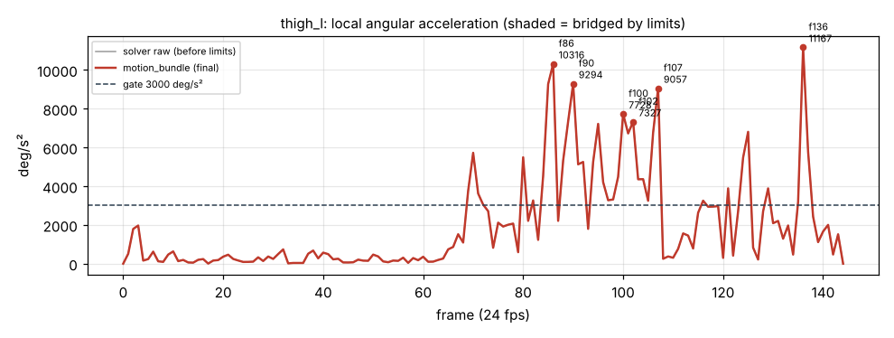

# v1_df1e — Высокий мах ЛЕВОЙ ногой вперёд с удержанием

**Вердикт: провал.** Уровень: *реализовано, функционально прогоняется*. **Качество не принято.**

## Что сломалось
- **Нога уходит не вперёд, а ВВЕРХ и чуть НАЗАД — получился вертикальный шпагат.** На 100 и 130 кадрах в боковом виде нога вертикальна в плоскости тела (бедро 150–155° от вертикали вниз, на 100 кадре бедро на 6 см позади плоскости тела). Стопа на высоте 1.68–1.71 м — выше макушки рига. В видео нога впереди тела, примерно 60° над горизонталью.
- **Колено «гуляет» внутрь-наружу при неподвижной ноге:** скрутка бедра +68° (90 кадр) → −68° (100) → 0 (108–116) → −28° (128–144).
- **Стопа повёрнута на 40° не туда** (кадры 102–123): лимит обрезал скрутку голени с −84° до −30°, стопа это не компенсировала.
- Фаза «складки» (86 кадр) — правильно: колено согнуто ~100–120°, бедро вперёд.

## Поведение суставов
- **Колено разгибается на 47° за один кадр** (85→86, 1 309 °/с; голень 21 064 °/с²).
- Бедро дрожит всё удержание (кадры 100–137 выше порога) — из-за прыгающей скрутки.
- Всего 81 точка выше порога; плечо левой руки 17 697 на 90 кадре.

## Причина бага (гипотеза или подтверждено)
- **Трекер (подтверждено):** сам MediaPipe направляет бедро почти вертикально вверх (компонента «вперёд» всего 0.04–0.20); длина бедра у трекера падает до 0.70 от нормы на 94 кадре — потеря глубины.
- **Внутренняя логика (подтверждено):** скрутка бедра берётся из плоскости сгиба колена, а после `debias` сгиб 3–14° — это шум, плоскость переворачивается → колено «гуляет».
- **Внутренняя логика (подтверждено):** клип скрутки голени длился 19 кадров (> `max_bridge_frames`=12), поэтому не заменён мостом, а оставлен обрезанным; стопа под обрезанной голенью не пересчитана → 40°.

## Что исправить агенту
1. **Блокер:** восстановление глубины (A1) — без него мах ногой невозможен.
2. `solver.bone_targets`: скрутку бедра брать по сырому сгибу минус bias с окном 15–35°; при малом весе — по направлению стопы; лимит скрутки бедра ±45°, плеча ±90° в `limits.py`.
3. `limits.py`: излишек скрутки голени при прямом колене → в бедро; после обрезания пересчитывать стопу.

Подробности и все числа: `dev_audit.json`; графики: `plots/`.
