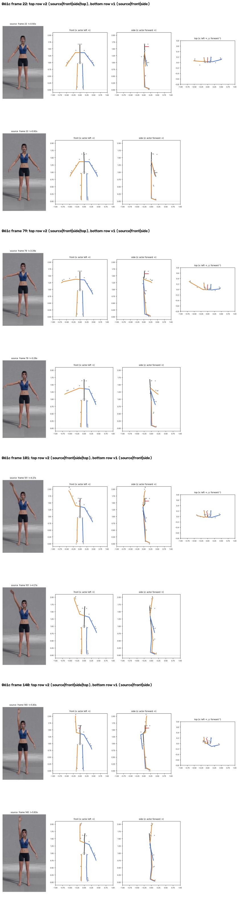
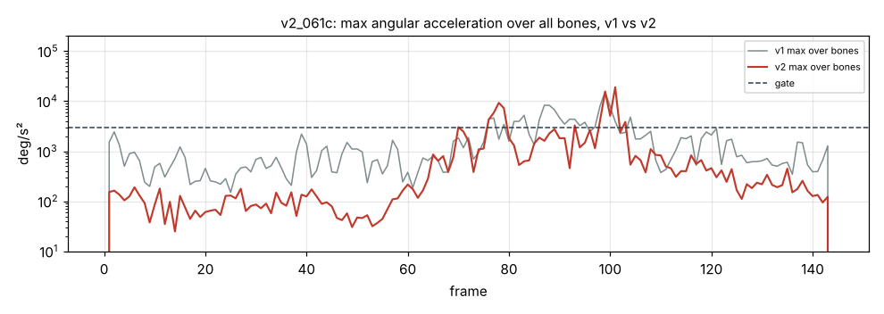

# v2_061c: Правая рука вверх через сторону

**Вердикт: частично; по корпусу хуже, чем в v1.** Уровень: *реализовано, функционально прогоняется*. **Качество не принято.**

## Что сломалось
- **Корпус поворачивается на 33°** к концу клипа (кадр 144). Неподвижная левая рука уходит назад, за спину; это видно на виде сбоку и сверху (`plots/v2_frame_140.png`). В видео корпус стоит ровно к камере. В v1 поворот был 5°.
- Голова в удержании повёрнута на −23°, оценка по 2D-точкам даёт −17°.
- Рывки: предплечье правой руки 19 057 °/с² на кадре 101 (в v1 было 15 360) и скачок 36° за кадр.
- Сама поднятая рука **правильная**: ошибка направления в плоскости кадра ≤ 1°, скрутка предплечья исправлена (25° → 0.2°), запаздывания нет.

## Поведение суставов
- Кадров выше порога 3000 °/с²: 36 → 17. Пики остались: плечо правой руки 7254 (кадр 79), предплечье 19 057 (кадр 101), кисть 11 734 (кадр 101).
- Уже в стойке правая рука отклонена из плоскости на 30°: ложная глубина. Из-за этого «смещение локтя» выросло до 61.6°, и сгибы до 62° обнуляются.

## Причина бага (гипотеза или подтверждено)
- **Восстановление глубины, длина сегмента (подтверждено):** `depth.py` берёт длину L как максимум из проекции в покое и 98-го перцентиля проекции за клип. Камера не ортографическая: конечность, вынесенная к камере, выглядит длиннее, и L получается на 10–25 % больше настоящей. Из-за этого глубина появляется даже в стойке, где её быть не должно, а затем и во всех остальных кадрах.
- **Знак глубины (подтверждено):** знак берётся из трекера в каждом кадре отдельно. Когда глубина у трекера проходит через ноль, восстановленная точка прыгает на 2·√(L²−d²): до 35–71 см за один кадр.
- Кадр 79: знак глубины плеча правой руки сменился, и локоть прыгнул на 35 см. Поворот корпуса вызывает восстановление глубины ключиц: если его выключить, поворот 4.6° вместо 33°.

## Что исправить агенту
1. **Блокер B1:** L брать из стойки (или учесть перспективу), не из 98-го перцентиля.
2. **Блокер B2:** знак глубины держать во времени и не переключать от кадра к кадру.
3. **B4:** глубину ключиц не восстанавливать по длине; поворот плечевой линии брать от таза с ограничением.
4. B8: ограничить смещение локтя/колена ~30°. B9: кисть правой руки, ошибка скрутки p95 13.8°.

Все числа и сравнение с v1 по каждой метрике: `dev_audit.json` → `v1_vs_v2`, `depth_rebuild_diagnostics`, `action_items`, `v1_action_items_status`. Графики: `plots/` (`acc_*.png` с отмеченными пиками, `cmp_*.png`).
