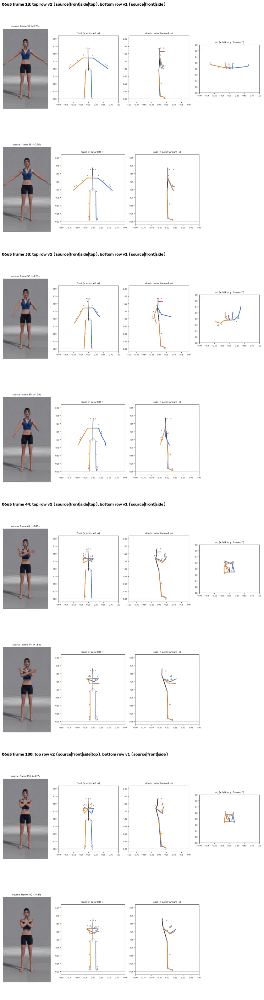
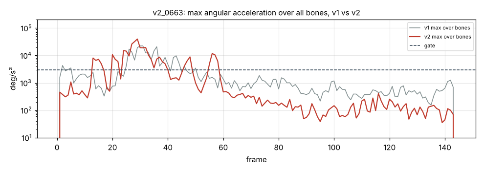

# v2_0663: Скрестить руки на груди, ладони на плечи

**Вердикт: провал (ближе к цели, чем v1).** Уровень: *реализовано, функционально прогоняется*. **Качество не принято.**

## Что сломалось
- **Ладони в 26–29 см от противоположных плеч** (в v1 было 37–38 см) и на 16–18 см впереди груди. На виде сбоку предплечья лежат горизонтально перед грудью (`plots/v2_frame_100.png`), а в видео ладони лежат на плечах.
- Локти согнуты на 98–104° (в v1 56–63°), стало лучше.
- **Голова повёрнута на −20°** с 44 кадра до конца, хотя человек смотрит прямо (`plots/cmp_head_yaw.png`). В v1 этого не было: это регресс.
- Предплечья всё ещё проходят друг сквозь друга (104 кадра < 5 см). Корпус откинут назад на 16.8° (в v1 20.2°).

## Поведение суставов
- Кадров выше порога 85 → 82. Пики **выросли**: предплечье правой руки 39 663 °/с² (кадр 29; в v1 20 776), кисть левой руки 31 918 (кадр 28), шея и голова 11 700 (кадр 56).
- Лимиты впервые срабатывают: мост на кадрах 27–30 у левой руки. Рывок при сведении рук всё равно остаётся.

## Причина бага (гипотеза или подтверждено)
- **Восстановление глубины, длина сегмента (подтверждено):** `depth.py` берёт длину L как максимум из проекции в покое и 98-го перцентиля проекции за клип. Камера не ортографическая: конечность, вынесенная к камере, выглядит длиннее, и L получается на 10–25 % больше настоящей. Из-за этого глубина появляется даже в стойке, где её быть не должно, а затем и во всех остальных кадрах.
- **Знак глубины (подтверждено):** знак берётся из трекера в каждом кадре отдельно. Когда глубина у трекера проходит через ноль, восстановленная точка прыгает на 2·√(L²−d²): до 35–71 см за один кадр.
- Голова: в стойке уши «развёрнуты» на 23° из-за завышенной L. Поправка покоя поглощает этот поворот, а когда ложная глубина пропадает, голова поворачивается на −20°. Если выключить восстановление глубины, поворот −1.3°.
- Ладони: предплечье поперёк груди ближе к камере и в кадре выглядит полной длины, поэтому считается лежащим в плоскости (гипотеза: перспектива).

## Что исправить агенту
1. **Блокер B2:** временной знак глубины (кадры 27–33, 57).
2. **B3:** рыскание головы считать по 2D (расстояние между ушами и смещение носа), L ушей брать из стойки.
3. **B5:** контакт ладоней с телом: учёт перспективы или «притяжение» к поверхности тела. Сначала проверить гипотезу.
4. B1, B6, B7 (наклон корпуса), B10 (разведение предплечий).

Все числа и сравнение с v1 по каждой метрике: `dev_audit.json` → `v1_vs_v2`, `depth_rebuild_diagnostics`, `action_items`, `v1_action_items_status`. Графики: `plots/` (`acc_*.png` с отмеченными пиками, `cmp_*.png`).
