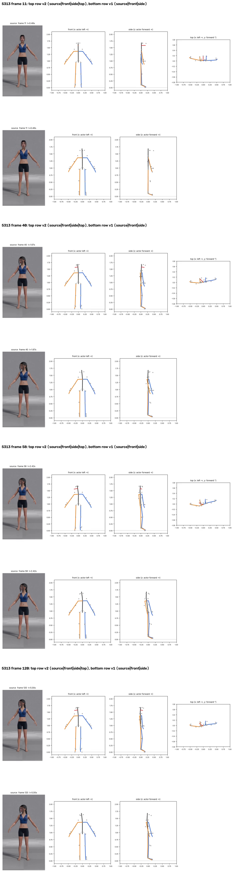
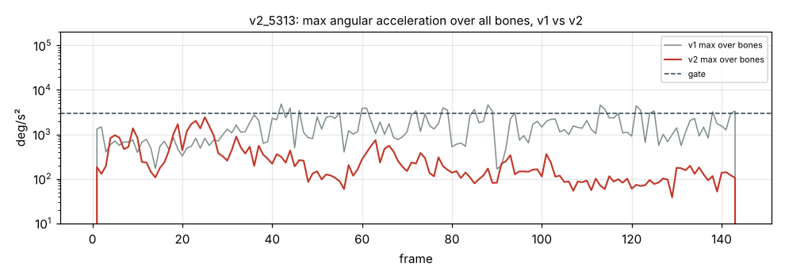

# v2_5313: Поворот головы вправо

**Вердикт: голова исправлена.** Уровень: *реализовано, функционально прогоняется*. **Качество не принято.**

## Что сломалось
- Существенных поломок нет. Голова держит −55°, оценка по 2D −49°; в v1 было −23° с откатом. Пик −65° на 58 кадре повторяет пик в 2D (−59°).
- Корпус доворачивается за головой на −21°, как и в v1; по видео это не подтверждено.

## Поведение суставов
- Ни одного кадра выше порога (в v1 было 20). Ошибка рыскания головы в удержании 5.5° (в v1 25.5°). Поворот в стойке 0° (в v1 +7°).

## Причина бага (гипотеза или подтверждено)
- Исправление v2 сработало: смещение головы в стойке калибруется полностью, а глубина ушей берётся из расстояния между ушами в 2D. Ложная глубина (B1) здесь мала: в стойке руки отклонены из плоскости до 19°.

## Что исправить агенту
1. Ничего срочного по этому клипу. После B1 проверить, что результат не ухудшился.

Все числа и сравнение с v1 по каждой метрике: `dev_audit.json` → `v1_vs_v2`, `depth_rebuild_diagnostics`, `action_items`, `v1_action_items_status`. Графики: `plots/` (`acc_*.png` с отмеченными пиками, `cmp_*.png`).
