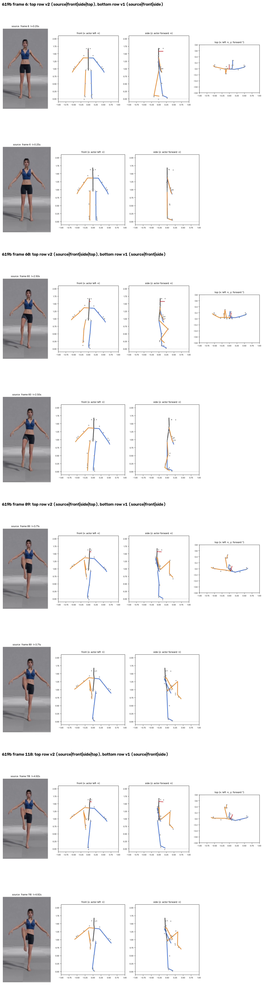
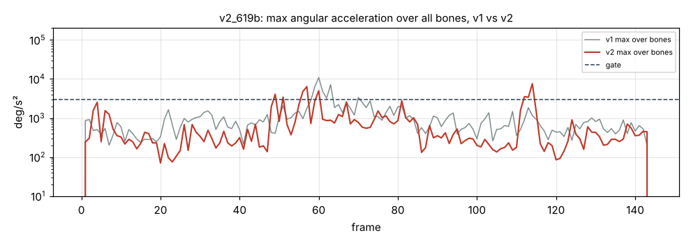

# v2_619b: Подъём правого колена

**Вердикт: в целом приемлемо, немного хуже v1.** Уровень: *реализовано, функционально прогоняется*. **Качество не принято.**

## Что сломалось
- **Поднятая голень направлена вперёд-вниз примерно на 45°**, а в видео она висит вертикально (`plots/v2_frame_089.png`).
- В стойке ноги «ножницами» ±10° на виде сбоку (ложная глубина).
- Голова повёрнута на +19°, хотя смотрит прямо.
- Бедро правильно: 131°, как в v1.

## Поведение суставов
- Кадров выше порога 12 → 15. Отрыв ноги стал мягче (бедро 5904 °/с² против 10 886, кадр 57), но появился пик у предплечья правой руки: 7554 на кадре 114 (в v1 3150).

## Причина бага (гипотеза или подтверждено)
- **Восстановление глубины, длина сегмента (подтверждено):** `depth.py` берёт длину L как максимум из проекции в покое и 98-го перцентиля проекции за клип. Камера не ортографическая: конечность, вынесенная к камере, выглядит длиннее, и L получается на 10–25 % больше настоящей. Из-за этого глубина появляется даже в стойке, где её быть не должно, а затем и во всех остальных кадрах.
- **Знак глубины (подтверждено):** знак берётся из трекера в каждом кадре отдельно. Когда глубина у трекера проходит через ноль, восстановленная точка прыгает на 2·√(L²−d²): до 35–71 см за один кадр.
- Голень: L взята из кадров с поднятой ногой (там голень ближе к камере), поэтому в стойке голень наклонена на 37.5° и «смещение колена» 39°.

## Что исправить агенту
1. **Блокер B1:** длина из стойки или перспектива.
2. B8: ограничить смещение колена. B3: голова. B6: пики.

Все числа и сравнение с v1 по каждой метрике: `dev_audit.json` → `v1_vs_v2`, `depth_rebuild_diagnostics`, `action_items`, `v1_action_items_status`. Графики: `plots/` (`acc_*.png` с отмеченными пиками, `cmp_*.png`).
