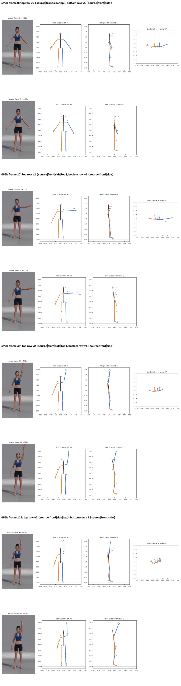
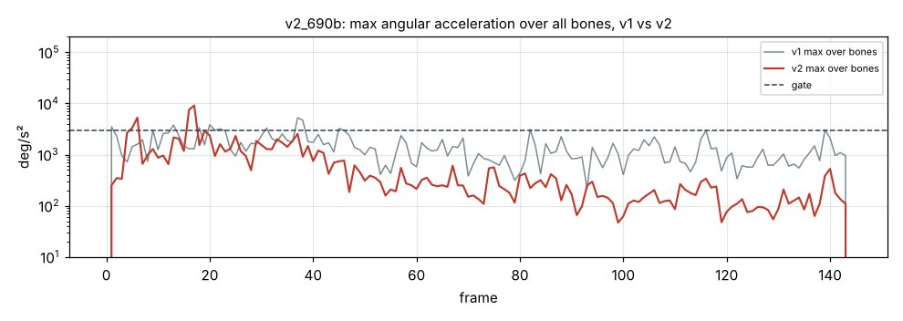

# v2_690b: Левая рука вверх через сторону

**Вердикт: хорошо, лучше v1.** Уровень: *реализовано, функционально прогоняется*. **Качество не принято.**

## Что сломалось
- Видимых поломок нет: траектория руки совпадает с видео, наверху кисть на 10 см впереди плеча (в v1 25 см).
- Корпус поворачивается на −18° к концу клипа (в v1 −11°).

## Поведение суставов
- Кадров выше порога 15 → 8, но пики выше: плечо 7558 °/с² и предплечье 9110 на кадрах 16–17 (в v1 3752 и 5262).
- **Фильтр не запаздывает:** сдвиг +0.24 кадра (в v1 +1.9), размах 139.7° против 139.4° в видео (`plots/cmp_lag_arm_l_chord_image_angle.png`).

## Причина бага (гипотеза или подтверждено)
- **Восстановление глубины, длина сегмента (подтверждено):** `depth.py` берёт длину L как максимум из проекции в покое и 98-го перцентиля проекции за клип. Камера не ортографическая: конечность, вынесенная к камере, выглядит длиннее, и L получается на 10–25 % больше настоящей. Из-за этого глубина появляется даже в стойке, где её быть не должно, а затем и во всех остальных кадрах.
- **Знак глубины (подтверждено):** знак берётся из трекера в каждом кадре отдельно. Когда глубина у трекера проходит через ноль, восстановленная точка прыгает на 2·√(L²−d²): до 35–71 см за один кадр.
- Предплечье в стойке отклонено из плоскости на 33°, поэтому смещение локтя 51.5°. На кадрах 16–17 рука проходит границу зоны «глубина по длине»: скачок 11 см и пик ускорения.

## Что исправить агенту
1. B1, B8, B6 (пики на кадрах 16–17), B4 (поворот корпуса).

Все числа и сравнение с v1 по каждой метрике: `dev_audit.json` → `v1_vs_v2`, `depth_rebuild_diagnostics`, `action_items`, `v1_action_items_status`. Графики: `plots/` (`acc_*.png` с отмеченными пиками, `cmp_*.png`).
