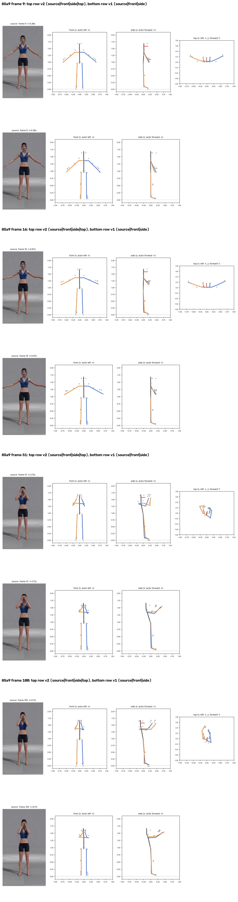
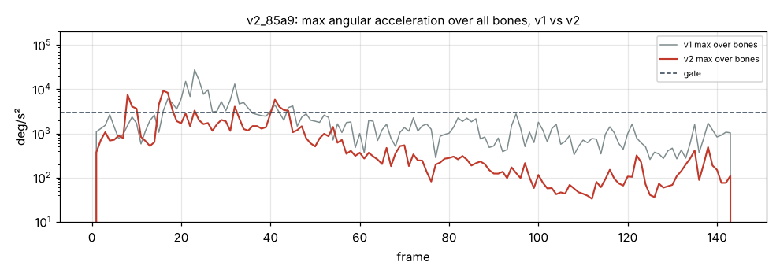

# v2_85a9: Закрыть лицо руками

**Вердикт: провал, лучше v1.** Уровень: *реализовано, функционально прогоняется*. **Качество не принято.**

## Что сломалось
- **Ладони в 34 и 49 см от лица** (в v1 48 и 52 см): предплечья вертикальные, кисти рядом с лицом и перед ним, а не на лице (`plots/v2_frame_051.png`).
- **Корпус повёрнут на 34°** (кадр 51; в v1 9°).
- «Руки зомби» и большой рывок v1 исчезли. Локти согнуты на 59–66° (в v1 21–31°).

## Поведение суставов
- Кадров выше порога 62 → 24. Максимум 9225 °/с² (плечо правой руки, кадр 16); в v1 было 27 643. Шея 4976 на кадре 41.

## Причина бага (гипотеза или подтверждено)
- **Восстановление глубины, длина сегмента (подтверждено):** `depth.py` берёт длину L как максимум из проекции в покое и 98-го перцентиля проекции за клип. Камера не ортографическая: конечность, вынесенная к камере, выглядит длиннее, и L получается на 10–25 % больше настоящей. Из-за этого глубина появляется даже в стойке, где её быть не должно, а затем и во всех остальных кадрах.
- **Знак глубины (подтверждено):** знак берётся из трекера в каждом кадре отдельно. Когда глубина у трекера проходит через ноль, восстановленная точка прыгает на 2·√(L²−d²): до 35–71 см за один кадр.
- Поворот корпуса: на 42 кадре сменился знак глубины ключиц (скачок 14 см). Без восстановления глубины поворот 8.5°.

## Что исправить агенту
1. **B5:** контакт ладоней с лицом.
2. **B4:** глубина ключиц и поворот корпуса.
3. B1, B2, B7, B8.

Все числа и сравнение с v1 по каждой метрике: `dev_audit.json` → `v1_vs_v2`, `depth_rebuild_diagnostics`, `action_items`, `v1_action_items_status`. Графики: `plots/` (`acc_*.png` с отмеченными пиками, `cmp_*.png`).
