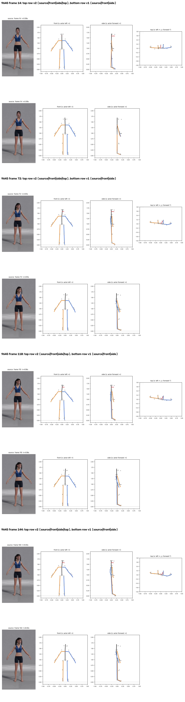
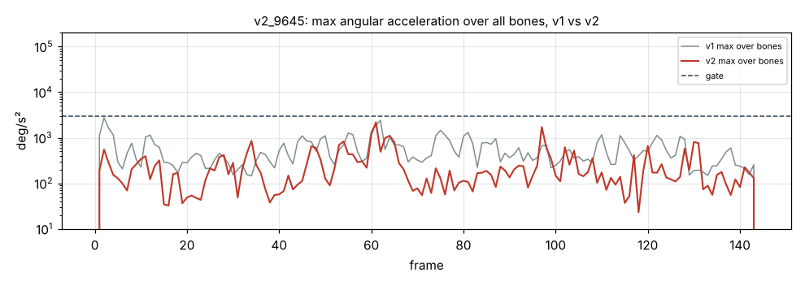

# v2_9645: Поворот головы влево

**Вердикт: голова исправлена, лучший клип.** Уровень: *реализовано, функционально прогоняется*. **Качество не принято.**

## Что сломалось
- Существенных поломок нет. Голова держит +40°, оценка по 2D +45° (в v1 было +14.5°). Отката нет.

## Поведение суставов
- Ни одного кадра выше порога. Ошибка рыскания головы в удержании 4.8° (в v1 30.2°). Руки в стойке отклонены из плоскости не больше чем на 12°.

## Причина бага (гипотеза или подтверждено)
- Исправления головы (поправка покоя по всем осям, глубина ушей из 2D) работают. Остаётся стабильный недобор около 5°.

## Что исправить агенту
1. Ничего срочного. После B1 проверить на регресс.

Все числа и сравнение с v1 по каждой метрике: `dev_audit.json` → `v1_vs_v2`, `depth_rebuild_diagnostics`, `action_items`, `v1_action_items_status`. Графики: `plots/` (`acc_*.png` с отмеченными пиками, `cmp_*.png`).
