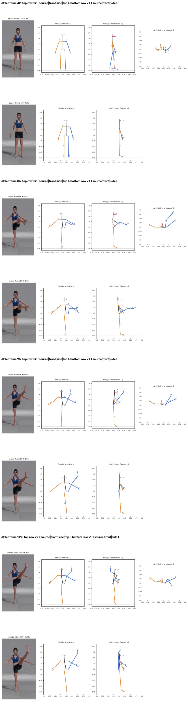
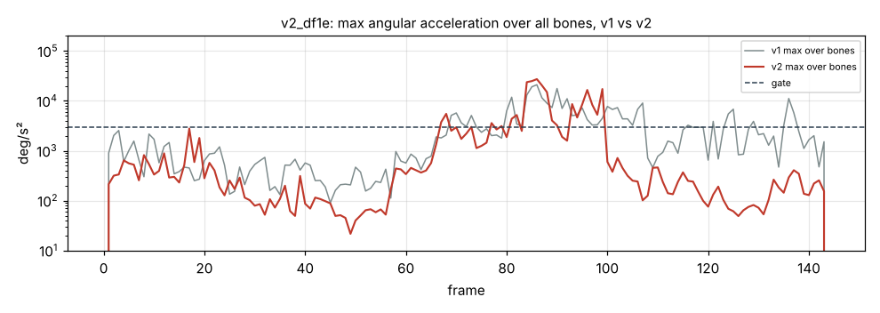

# v2_df1e: Высокий мах левой ногой вперёд с удержанием

**Вердикт: провал, новый вид ошибки.** Уровень: *реализовано, функционально прогоняется*. **Качество не принято.**

## Что сломалось
- **Нога «складывается»:** с 95 кадра до конца колено согнуто на 80°, голень уходит назад-вверх, стопа за телом (`plots/v2_frame_120.png`). В видео нога прямая и вытянута вперёд-вверх.
- Бедро теперь направлено правильно, вперёд-вверх (около 60° над горизонталью); в v1 был вертикальный шпагат.
- Опорная стопа уходит на 1–2 см под пол на кадрах 99–105.

## Поведение суставов
- Кадров выше порога 81 → 38, но пики выше v1: стопа 27 296 °/с² (кадр 86), голень 23 733 (кадр 84), бедро 19 717 (кадр 85).
- Скрутка бедра в удержании больше не гуляет (+80…+88°), но держится в неправильной, сложенной позе. Голень зажата лимитом в 55 кадрах.

## Причина бага (гипотеза или подтверждено)
- **Восстановление глубины, длина сегмента (подтверждено):** `depth.py` берёт длину L как максимум из проекции в покое и 98-го перцентиля проекции за клип. Камера не ортографическая: конечность, вынесенная к камере, выглядит длиннее, и L получается на 10–25 % больше настоящей. Из-за этого глубина появляется даже в стойке, где её быть не должно, а затем и во всех остальных кадрах.
- **Знак глубины (подтверждено):** знак берётся из трекера в каждом кадре отдельно. Когда глубина у трекера проходит через ноль, восстановленная точка прыгает на 2·√(L²−d²): до 35–71 см за один кадр.
- На кадрах 95–98 знак глубины голени меняется 4 раза, скачок 71 см за кадр; в итоге остаётся неверный знак. Уже в стойке голень наклонена назад на 37° (L завышена), отсюда смещение колена 40°.

## Что исправить агенту
1. **Блокер B2:** знак глубины во времени плюс проверка на «складывание» (колено не сгибается назад, стопа не уходит за бедро при поднятом бедре).
2. **Блокер B1:** длина голени из стойки или перспектива.
3. B6, B8, B9.

Все числа и сравнение с v1 по каждой метрике: `dev_audit.json` → `v1_vs_v2`, `depth_rebuild_diagnostics`, `action_items`, `v1_action_items_status`. Графики: `plots/` (`acc_*.png` с отмеченными пиками, `cmp_*.png`).
