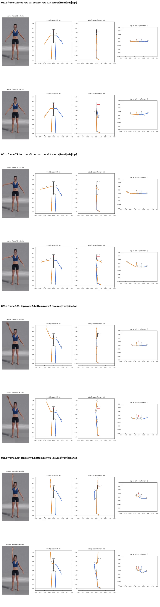
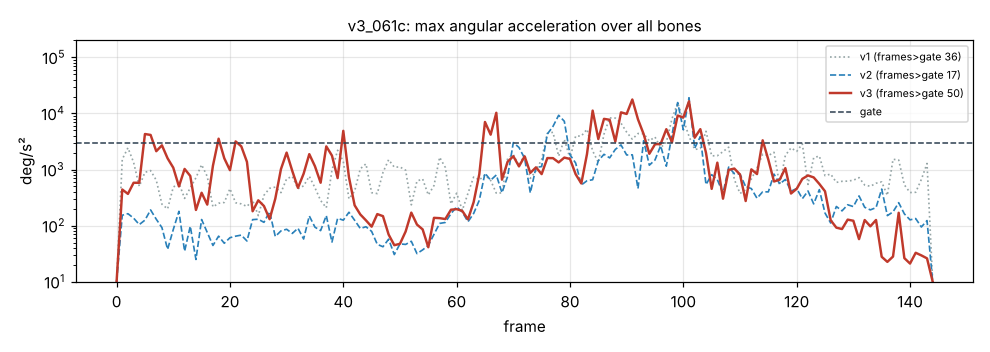

# v3_061c: Правая рука вверх через сторону

**Вердикт: частично (как v2); рывков больше.** Уровень: *реализовано, функционально прогоняется*. **Качество не принято.**

## Что сломалось
- **Корпус всё ещё повёрнут на 33°** к концу клипа (кадр 144), левая рука уходит за спину (вид сверху и сбоку). В видео корпус стоит ровно.
- Исправлено: в стойке руки и ноги лежат во фронтальной плоскости (отклонение ≤ 1°, в v2 правая рука была на 30°). Голова в удержании −15°, по 2D −17° (в v2 −23°).
- Поднятая рука совпадает с видео, запаздывания нет.

## Поведение суставов
- Кадров выше порога 3000 °/с²: v1 36 → v2 17 → **v3 50**. Пики: плечо правой руки 16 264 (кадр 91), предплечье 17 727 (кадр 91), кисть 10 108 (кадр 101).
- Кадры 38–41: скрутка неподвижного левого плеча прыгает −24° → 0° (4896 °/с²).

## Причина бага (гипотеза или подтверждено)
- **Поворот корпуса (подтверждено в v2, не исправлялось):** глубина ключиц по длине поворачивает линию плеч, когда плечевые точки смещаются вместе с руками.
- **Скрутка плеча (подтверждено):** смещение локтя в стойке теперь всего 4–9°. Поэтому у неподвижной или медленной руки «очищенный» сгиб локтя часто 5–20°, то есть прямо в окне 2–10°, где вес скрутки плеча переключается с 0 на 1. Скрутка перескакивает на 20–40° за 1–2 кадра.

## Что исправить агенту
1. **C3:** убрать ложный поворот корпуса (ключицы не восстанавливать по длине).
2. **C2:** расширить окно веса скрутки плеча (примерно 15–35°) или сгладить вес во времени.
3. C4: модель перспективы.

Числа: `dev_audit.json` → `v2_vs_v3`, `v1_vs_v3`, `depth_rebuild_diagnostics`, `action_items`, `v2_action_items_status`. Графики: `plots/acc_*.png` (пики отмечены), `cmp_*_v1_v2_v3.png`.
