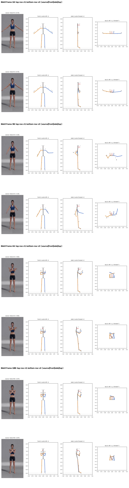
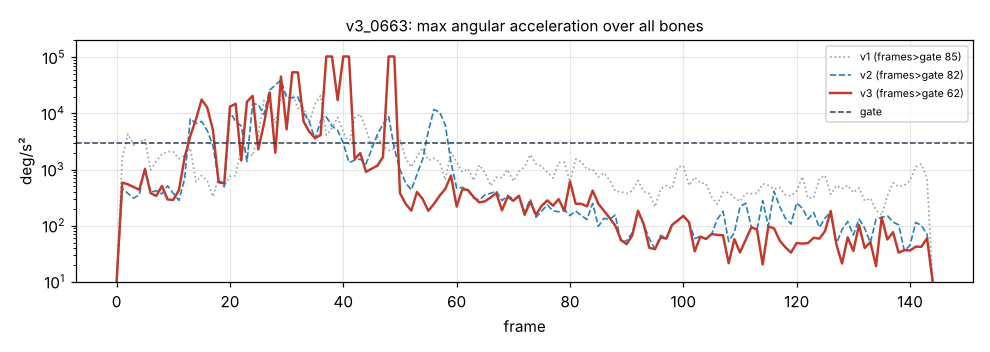

# v3_0663: Скрестить руки на груди

**Вердикт: провал.** Уровень: *реализовано, функционально прогоняется*. **Качество не принято.**

## Что сломалось
- **Ладони в 27 и 23 см от противоположных плеч** (в v2 26 и 29) и на 22–26 см впереди груди. В видео ладони на плечах.
- **Самый сильный рывок за все версии:** кисть левой руки 103 718 °/с² на кадре 37.
- Исправлено: голова прямая (−2°, в v2 −20°), корпус больше не откидывается назад (наклон ≤ 1°, в v2 16.8°).
- Предплечья проходят друг сквозь друга (104 кадра < 5 см).

## Поведение суставов
- Кадров выше порога 85 → 82 → 62. Пики: кисть левой руки 103 718 (кадр 37), плечо левой руки 45 607 (кадр 29), правой 20 314 (кадр 24).

## Причина бага (гипотеза или подтверждено)
- **Знак глубины (подтверждено):** знак держится по предыдущему кадру только пока трекер «не уверен» (|dz| < 0.3·L). Когда сам трекер уверенно меняет знак, точка всё равно прыгает на 36–47 см за кадр.
- На кадрах 28, 31, 32 и 39 знак глубины рук меняется, скачки 42, 47 и 36 см.
- **Перспектива (подтверждено по данным):** L теперь берётся из стойки, и в стойке это правильно. Но конечность, идущая к камере, выглядит длиннее (проекция до 1.2–1.33·L), её глубина обрезается до 0, и конечность кладётся в плоскость кадра как раз тогда, когда она направлена в камеру.

## Что исправить агенту
1. **Блокер C1:** знак глубины держать во времени и тогда, когда трекер «уверен» (смену знака принимать, только если она держится ≥ 3 кадров, или выбирать всю последовательность знаков сразу).
2. **C4:** перспектива.
3. C6: разведение предплечий.

Числа: `dev_audit.json` → `v2_vs_v3`, `v1_vs_v3`, `depth_rebuild_diagnostics`, `action_items`, `v2_action_items_status`. Графики: `plots/acc_*.png` (пики отмечены), `cmp_*_v1_v2_v3.png`.
