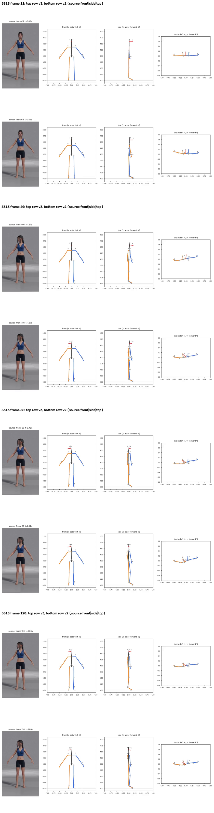
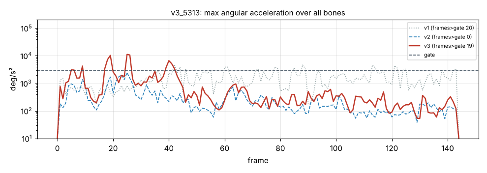

# v3_5313: Поворот головы вправо

**Вердикт: голова хорошо, но появились рывки руки.** Уровень: *реализовано, функционально прогоняется*. **Качество не принято.**

## Что сломалось
- Голова −51°, по 2D −49° (ошибка 1.9°), отката нет.
- **Новое:** неподвижная левая рука дёргается на кадрах 24–26.

## Поведение суставов
- Кадров выше порога 20 → 0 → **19**. Пики: плечо левой руки 11 205 °/с² (кадр 25), шея 6636 (кадр 40).

## Причина бага (гипотеза или подтверждено)
- **Скрутка плеча (подтверждено):** смещение локтя в стойке теперь всего 4–9°. Поэтому у неподвижной или медленной руки «очищенный» сгиб локтя часто 5–20°, то есть прямо в окне 2–10°, где вес скрутки плеча переключается с 0 на 1. Скрутка перескакивает на 20–40° за 1–2 кадра.
- Кадры 24–26: скрутка левого плеча −19° → 0°, пока сгиб падает 8° → 0°.

## Что исправить агенту
1. **C2:** окно веса скрутки плеча.

Числа: `dev_audit.json` → `v2_vs_v3`, `v1_vs_v3`, `depth_rebuild_diagnostics`, `action_items`, `v2_action_items_status`. Графики: `plots/acc_*.png` (пики отмечены), `cmp_*_v1_v2_v3.png`.
