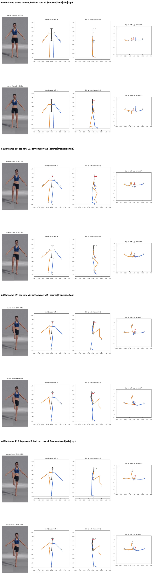
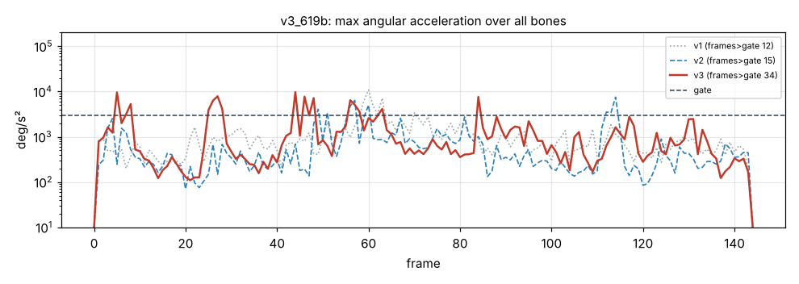

# v3_619b: Подъём правого колена

**Вердикт: лучше v2; голова повёрнута ложно.** Уровень: *реализовано, функционально прогоняется*. **Качество не принято.**

## Что сломалось
- Исправлено: поднятая голень висит вертикально (в v2 была наклонена вперёд на 45°), опорная нога прямая.
- **Голова повёрнута на +20°** (вид сверху, `plots/v3_frame_118.png`), хотя смотрит прямо.

## Поведение суставов
- Кадров выше порога 12 → 15 → **34**. Пики: плечо левой руки 9658 (кадр 44), предплечье правой руки 7707 (кадр 46), бедро 5045 на отрыве (кадр 57; в v1 10 886).

## Причина бага (гипотеза или подтверждено)
- **Скрутка плеча (подтверждено):** смещение локтя в стойке теперь всего 4–9°. Поэтому у неподвижной или медленной руки «очищенный» сгиб локтя часто 5–20°, то есть прямо в окне 2–10°, где вес скрутки плеча переключается с 0 на 1. Скрутка перескакивает на 20–40° за 1–2 кадра.
- Голова: без восстановления глубины +10.9°, в v1 +8.8°. Причина ложного поворота головы не найдена (гипотеза: точки ушей и носа при наклоне головы).

## Что исправить агенту
1. **C5:** рыскание головы объединять с 2D-оценкой (расстояние между ушами и смещение носа).
2. C2, C1 (смена знака голени на 63 кадре, 14 см).

Числа: `dev_audit.json` → `v2_vs_v3`, `v1_vs_v3`, `depth_rebuild_diagnostics`, `action_items`, `v2_action_items_status`. Графики: `plots/acc_*.png` (пики отмечены), `cmp_*_v1_v2_v3.png`.
