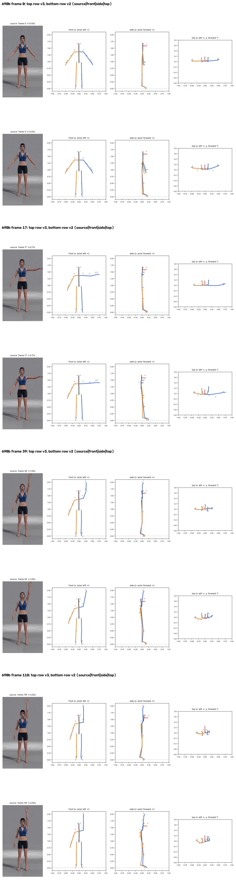
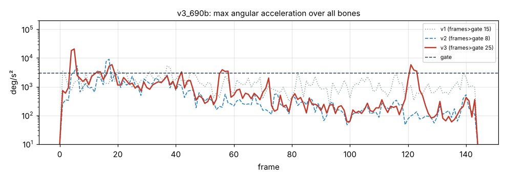

# v3_690b: Левая рука вверх через сторону

**Вердикт: хорошо.** Уровень: *реализовано, функционально прогоняется*. **Качество не принято.**

## Что сломалось
- Видимых поломок нет: рука совпадает, наверху кисть на 3 см впереди плеча (в v2 10, в v1 25). Запаздывания нет (+0.09 кадра).

## Поведение суставов
- Кадров выше порога 15 → 8 → **25**. Пик предплечья 20 711 °/с² на 5 кадре: начало подъёма, скрутка плеча 0 → −31° за кадр.

## Причина бага (гипотеза или подтверждено)
- **Скрутка плеча (подтверждено):** смещение локтя в стойке теперь всего 4–9°. Поэтому у неподвижной или медленной руки «очищенный» сгиб локтя часто 5–20°, то есть прямо в окне 2–10°, где вес скрутки плеча переключается с 0 на 1. Скрутка перескакивает на 20–40° за 1–2 кадра.

## Что исправить агенту
1. **C2:** окно веса скрутки плеча.

Числа: `dev_audit.json` → `v2_vs_v3`, `v1_vs_v3`, `depth_rebuild_diagnostics`, `action_items`, `v2_action_items_status`. Графики: `plots/acc_*.png` (пики отмечены), `cmp_*_v1_v2_v3.png`.
