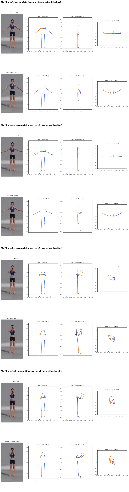
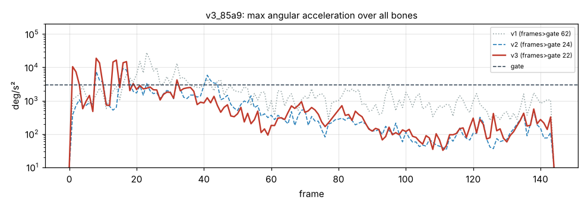

# v3_85a9: Закрыть лицо руками

**Вердикт: провал, но заметно ближе.** Уровень: *реализовано, функционально прогоняется*. **Качество не принято.**

## Что сломалось
- **Ладони в 16 и 36 см от лица** (в v2 34 и 49, в v1 48 и 52), локти согнуты на 98° и 90°.
- **Корпус повёрнут на 31°** (кадр 52), в видео стоит ровно.

## Поведение суставов
- Кадров выше порога 62 → 24 → 22. Пики: плечо правой руки 18 775 (кадр 8), левой 14 466 (кадр 13). Шея спокойная (501).

## Причина бага (гипотеза или подтверждено)
- **Перспектива (подтверждено по данным):** L теперь берётся из стойки, и в стойке это правильно. Но конечность, идущая к камере, выглядит длиннее (проекция до 1.2–1.33·L), её глубина обрезается до 0, и конечность кладётся в плоскость кадра как раз тогда, когда она направлена в камеру.
- **Поворот корпуса (подтверждено в v2, не исправлялось):** глубина ключиц по длине поворачивает линию плеч, когда плечевые точки смещаются вместе с руками.

## Что исправить агенту
1. **C4:** перспектива (ладони до лица).
2. **C3:** поворот корпуса.
3. C2.

Числа: `dev_audit.json` → `v2_vs_v3`, `v1_vs_v3`, `depth_rebuild_diagnostics`, `action_items`, `v2_action_items_status`. Графики: `plots/acc_*.png` (пики отмечены), `cmp_*_v1_v2_v3.png`.
