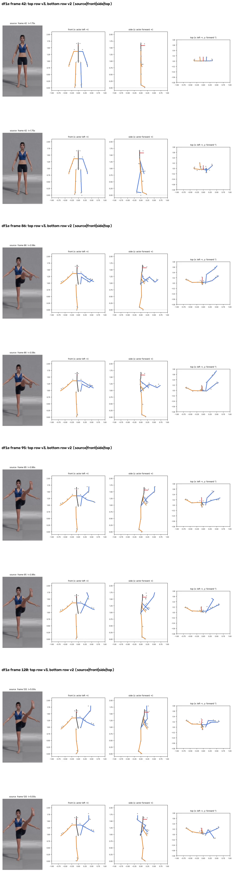
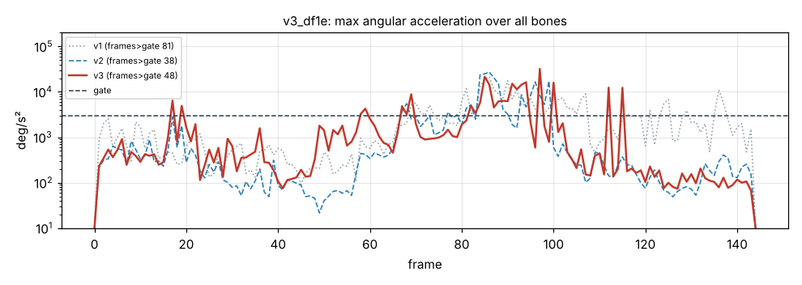

# v3_df1e: Высокий мах левой ногой

**Вердикт: провал, но лучше v2.** Уровень: *реализовано, функционально прогоняется*. **Качество не принято.**

## Что сломалось
- Нога больше не складывается назад: стопа на 20 см впереди таза (в v2 на 9 см позади), бедро идёт вперёд-вверх.
- **Колено в удержании согнуто на 45°**, голень идёт вертикально вверх от колена (`plots/v3_frame_120.png`). В видео нога прямая.

## Поведение суставов
- Кадров выше порога 81 → 38 → 48. Пики: плечо левой руки 32 018 (кадр 97), голень 21 550 (кадр 85), стопа 15 563 (кадр 85).

## Причина бага (гипотеза или подтверждено)
- **Перспектива (подтверждено по данным):** L теперь берётся из стойки, и в стойке это правильно. Но конечность, идущая к камере, выглядит длиннее (проекция до 1.2–1.33·L), её глубина обрезается до 0, и конечность кладётся в плоскость кадра как раз тогда, когда она направлена в камеру.
- Голень: проекция до 1.32·L, глубина обрезана до 0.
- **Знак глубины (подтверждено):** знак держится по предыдущему кадру только пока трекер «не уверен» (|dz| < 0.3·L). Когда сам трекер уверенно меняет знак, точка всё равно прыгает на 36–47 см за кадр.
- Голень: смены знака на кадрах 83 и 86, скачок 45 см.

## Что исправить агенту
1. **C4:** перспектива (голень к камере).
2. **Блокер C1:** знак глубины во времени.
3. C2.

Числа: `dev_audit.json` → `v2_vs_v3`, `v1_vs_v3`, `depth_rebuild_diagnostics`, `action_items`, `v2_action_items_status`. Графики: `plots/acc_*.png` (пики отмечены), `cmp_*_v1_v2_v3.png`.
